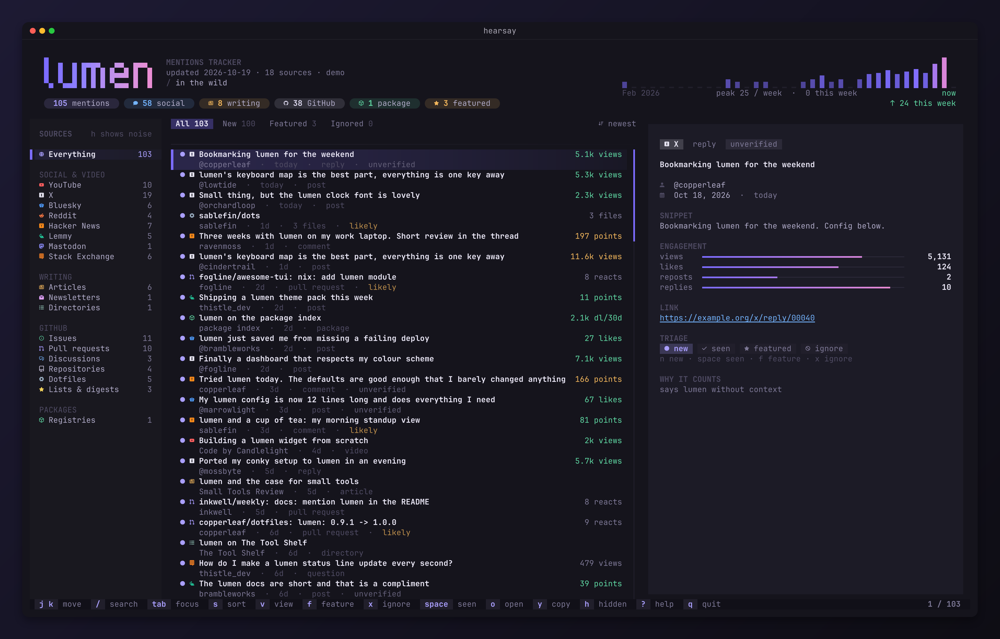
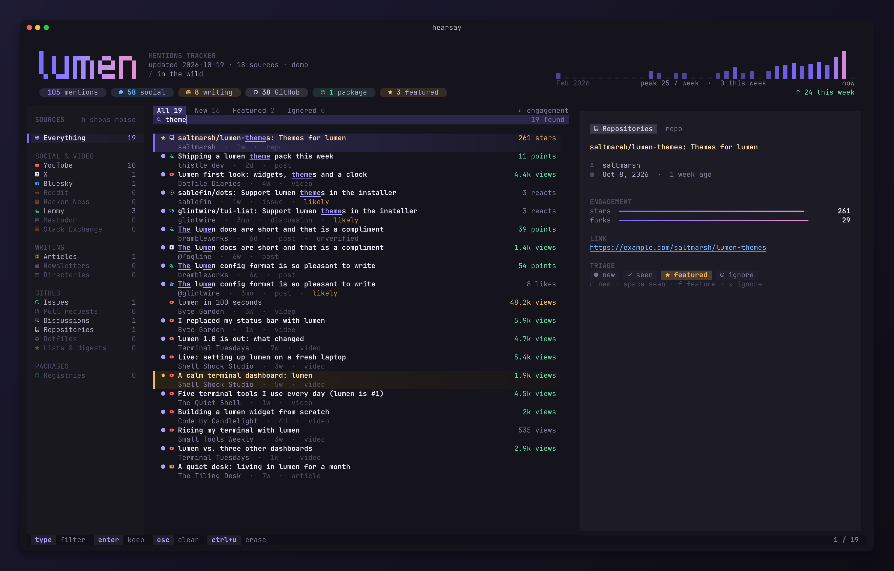
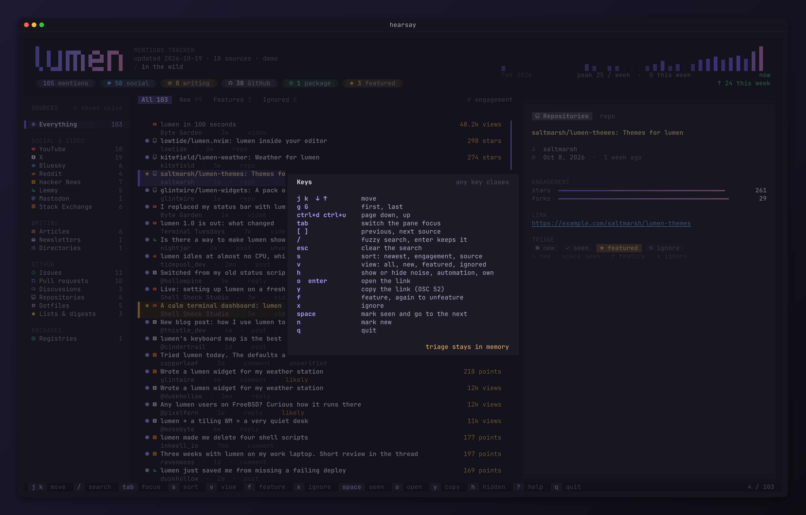
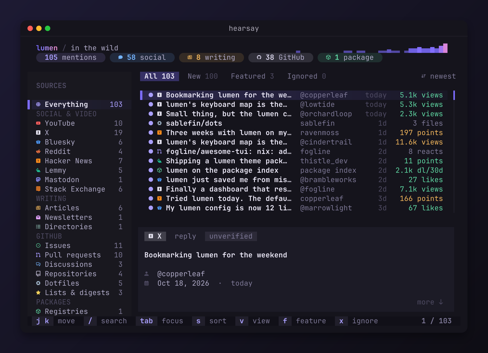
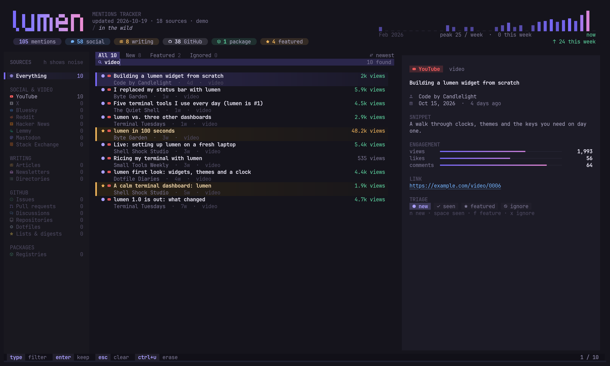

# hearsay

A terminal viewer for the places your project is talked about: videos,
posts, articles, issues, packages and more. It reads one JSON feed, shows it
with a fuzzy search and filters, and keeps your triage in a local file. The
same program runs in a browser.



The screenshots show the bundled demo. Every name and link in it is made up.

## What it does

- Shows every mention in one list, newest first, or by engagement or source.
- Groups the sources in a sidebar: social sites, writing, GitHub, packages.
- Draws the project name as a wordmark, with a weekly histogram and totals.
- Finds rows with a fuzzy search over titles, authors, excerpts and links.
- Marks rows as new, seen, featured or ignored. The marks go to a local file.
- Hides noise, bot activity and your own posts until you press `h`.
- Fits the screen: three panes on a wide terminal, a stacked view on a small one.
- Writes a public feed with only the rows you featured.

| Search | Help |
| --- | --- |
|  |  |

At 100 by 30 cells the preview moves below the list:



## Install

```sh
go install github.com/Gaurav-Gosain/hearsay@latest
```

Or build from a clone:

```sh
go build -o hearsay .
```

Use a font with Nerd Font glyphs, or pass `--ascii`.

## Use

```sh
hearsay --demo                      # the bundled sample
hearsay mentions.json               # a feed file
hearsay https://example.com/m.json  # a feed URL
hearsay validate mentions.json      # check a feed
hearsay publish -o public.json mentions.json
```

| Flag | What it does |
| --- | --- |
| `--state FILE` | The triage file. The default is `<feed>.state.json` next to a file feed, or a file under `~/.local/state/hearsay/` for a URL. |
| `--read-only` | Keep triage in memory. Write nothing. |
| `--name`, `--subtitle` | Change the project name and the line under it. |
| `--accent`, `--accent2` | Change the colours, as `#rrggbb`. |
| `--ascii` | Use ASCII marks in place of Nerd Font glyphs. Also `HEARSAY_ASCII=1`. |

`HEARSAY_FEED` sets the feed when you give none.

### Keys

| Key | What it does |
| --- | --- |
| `j` `k`, arrows | Move |
| `g` `G` | Go to the first or the last row |
| `ctrl+d` `ctrl+u` | Move a page down or up |
| `tab` | Move the focus between the panes |
| `[` `]` | Go to the previous or the next source |
| `/` | Search. `enter` keeps the search, `esc` clears it |
| `s` | Sort by newest, engagement or source |
| `v` | Show all, new, featured or ignored rows |
| `h` | Show or hide noise, bot activity and your own posts |
| `o`, `enter` | Open the link |
| `y` | Copy the link |
| `f` | Feature the row. Press it again to remove the star |
| `x` | Ignore the row |
| `space` | Mark the row as seen and go to the next one |
| `n` | Mark the row as new |
| `?` | Show the keys |
| `q` | Quit |

The mouse works too: click a source, a row, a tab or a triage button, and
scroll a pane.

## The feed

The feed is one JSON file. Any collector in any language can write it.
[docs/feed.md](docs/feed.md) is the spec, and
[feed/schema.json](feed/schema.json) is the JSON Schema. The smallest feed:

```json
{
  "version": 1,
  "project": { "name": "lumen" },
  "generated": "2026-10-19T08:00:00Z",
  "items": [
    {
      "id": "3f1c9a0b2d4e5f60",
      "source": "youtube",
      "kind": "video",
      "url": "https://example.com/video/1",
      "title": "A first look at lumen",
      "metrics": { "views": 1520, "likes": 64 }
    }
  ]
}
```

The project name, the colours and any extra sources come from the feed. A Go
collector can use the `feed` package to write the file.

Triage never goes into the feed. It goes into a separate state file, so a
collector can rewrite the feed at any time.

## A public page

`hearsay publish` writes a feed with only the rows you featured. It drops
the relevance, the reasons, the file lists and the seen times. Put that file
next to the browser build to show your project's mentions on a web page.

## In the browser

The `wasm` folder builds the same program for the browser. It uses the
xterm.js bundle and the JetBrains Mono Nerd Font files from
[sip](https://github.com/Gaurav-Gosain/sip).

```sh
wasm/build.sh dist public.json   # the static folder, with the feed as mentions.json
node wasm/serve.mjs dist 8765    # try it at http://127.0.0.1:8765
```



- The page reads `mentions.json` next to it. `?feed=URL` reads another feed.
  `?demo` shows the demo.
- Triage stays in the browser's local storage. Nothing goes back to a server.
- Only `hearsay.wasm.br` and `hearsay.wasm.gz` ship, about 1.6 MB and 2.2 MB.
  A host that cannot serve them with `Content-Encoding` makes the page unpack
  the gzip file itself.
- `wasm/prepare.sh` patches a copy of Bubble Tea so it builds for js. It does
  not change `go.mod`.
- `node wasm/capture.mjs dist shots` loads the build in headless Chromium,
  checks that triage survives a second visit, and writes screenshots. It needs
  `playwright-core`.

## Demo data

`internal/demo/sample.json` is the demo feed. `go run gen/main.go` in
`internal/demo` writes it again. Every name, handle and title is invented,
and every link points at `example.com`, `example.org` or `example.net`.

## Licence

MIT. See [LICENSE](LICENSE).
